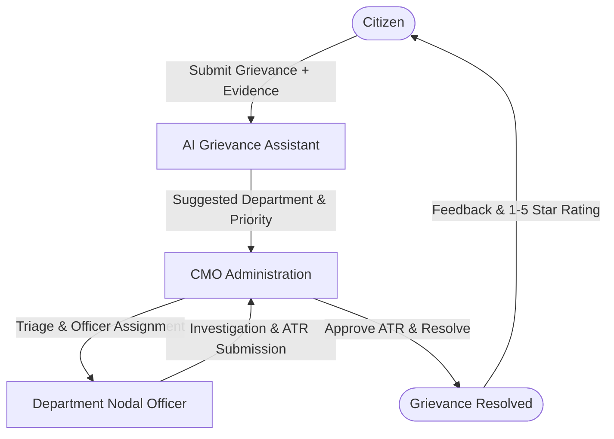

# Janaseva Kerala — Project Overview

> **Chief Minister's Public Grievance Redressal Portal**  
> *Civic Governance and Public Redressal Management Platform*

---

> [!WARNING]
> ### Prototype Evaluation Disclaimer
> **This system is an evaluation prototype developed for WhiteMatrix Software Solutions.**  
> It is **NOT** an official portal, service, or representation of the Government of Kerala, the Chief Minister's Office (CMO), or any statutory department. All names, designations, and government references are utilized strictly for realistic demonstration and architectural evaluation purposes.

---

## 1. Executive Summary

**Janaseva Kerala** is a full-stack public grievance redressal portal designed to connect citizens with state government administration. Inspired by public grievance redressal mechanisms, Janaseva Kerala manages the registration, assignment, field investigation, and resolution of citizen complaints across all 14 revenue districts of Kerala.

The platform provides an end-to-end workflow across three operational tiers:
1. **Citizens**: Submit complaints across standard civic categories, upload supporting evidence (images/PDFs), monitor progress with unique reference numbers (`JK-YYYY-XXXXXX`), receive in-app alerts, and provide resolution feedback.
2. **Department Nodal Officers**: Review department queues (e.g., PWD, KSEB, Water Resources, Health), track field investigation progress, and submit formal **Action Taken Reports (ATRs)**.
3. **Chief Minister's Office (CMO) Administrators**: Maintain statewide oversight, triage incoming grievances, route cases to departments and designated officers, register and manage department officers, review ATR submissions, log confidential internal remarks, enforce SLAs, and monitor statewide analytics.

An **AI Grievance Assistant** powered by **Google Gemini AI (`gemini-2.5-flash`)** provides real-time advisory suggestions for department routing, grievance categorization, urgency prioritization, and concise executive summarization. A deterministic rule-based heuristic fallback engine ensures reliable offline operation when an external API key is not configured or network connectivity is unavailable.

---

## 2. Problem Statement & Solutions

| Operational Challenge | Janaseva Kerala Solution |
| :--- | :--- |
| **Physical Petition Bottlenecks**<br>Citizens traditionally travel to district collectorates or administrative offices to submit paper petitions. | **Web-Based Portal Access**<br>Mobile-responsive React application accessible 24/7 from any device across Kerala's 14 districts. |
| **Opaque Tracking**<br>Citizens receive little or no status visibility after submitting petitions. | **Real-Time Status & Audit Trail**<br>Unique reference tracking (`JK-YYYY-XXXXXX`) with timestamped status history and public tracking without requiring sign-in. |
| **Inter-Departmental Misrouting**<br>Complaints are misrouted between overlapping departments. | **AI-Assisted Triage & CMO Assignment**<br>Gemini-driven categorization combined with centralized CMO administrative assignment and officer selection. |
| **Accountability Gaps**<br>Complaints marked resolved without substantive investigation evidence. | **Action Taken Reports (ATRs)**<br>Officers must submit investigation findings and documentation for CMO review before a grievance can be resolved. |
| **Lack of Citizen Verification**<br>Redressal quality evaluated without citizen input. | **Citizen Satisfaction Feedback**<br>Citizens submit 1 to 5 star ratings and qualitative reviews after resolution. |

---

## 3. Core Capabilities & Feature Matrix



### 3.1 Citizen Portal
- **Authentication**: Email-based registration and login with JWT access and refresh token management.
- **Grievance Submission**: Structured submission capturing district, category, subject, detailed description, and document uploads (images/PDFs up to 10MB).
- **AI-Assisted Recommendations**: Real-time evaluation pill displaying suggested department, category, priority, and summary before submission with a human-in-the-loop application control.
- **Public Reference Tracking**: Instant lookup via reference number (`JK-YYYY-XXXXXX`) without authentication.
- **In-App Notification Center**: Alerts for status transitions, department assignments, and resolution updates.
- **Citizen Feedback**: Post-resolution satisfaction ratings (1–5 stars) and qualitative commentary.
- **Functional User Profile**: View verified credentials, update contact information and address, and change passwords.

### 3.2 Department Officer Portal
- **Department-Scoped Workspace**: Officers view grievances assigned specifically to their department.
- **Investigation Lifecycle Management**: Update grievance progress across defined states (`Under Review`, `In Progress`).
- **Action Taken Report (ATR) Submission**: Submit formal investigation findings and upload supporting evidence for CMO verification.
- **SLA & Due Date Tracking**: Monitor investigation timelines against targeted resolution windows.
- **Functional Officer Profile**: View verified official credentials, designation, employee ID, and change passwords.

### 3.3 CMO Administration Portal
- **Statewide Grievance Overview**: Monitor volume, resolution rates, average turnaround time, and open caseload.
- **Triage & Department Assignment**: Route grievances to any of the 8 active departments and assign specific nodal officers.
- **Officer Management**: Register department officers, view officer directories with live workloads, update officer details, and activate/deactivate accounts.
- **Confidential Internal Remarks**: Administrative annotations visible exclusively to CMO staff.
- **ATR Verification Workflow**: Review submitted ATRs with options to **Approve**, **Reject**, or **Request Revision**.
- **Statewide Analytics**: District distributions, departmental workloads, category breakdowns, and monthly trends using Recharts.

---

## 4. Demonstration Accounts

The system includes pre-seeded demonstration accounts:

| Role | Email | Password | Scope & Authority |
| :--- | :--- | :--- | :--- |
| **CMO Administrator** | `cmo@janaseva.kerala.gov.in` | `admin123` | Statewide administration across all 14 districts and 8 departments. Full triage, officer management, ATR approval, internal remarks, and analytics. |
| **Department Officer** | `officer.pwd@janaseva.kerala.gov.in` | `officer123` | Er. Rajesh Kumar — PWD Executive Engineer. Handles Public Works grievances, updates investigation progress, and submits ATRs. *(Additional officers seeded for Health, Education, LSGD, WRD, KSEB, Transport, Revenue with password `officer123`)*. |
| **Citizen** | `citizen@example.com` | `citizen123` | Kavitha R Nair — Thiruvananthapuram resident. Submits grievances, tracks progress, and leaves satisfaction feedback. |

---

## 5. Technology Stack Summary

```
+-----------------------------------------------------------------------------------+
|                                 CLIENT LAYER                                      |
|    React 19  *  Vite 6  *  Tailwind CSS 4  *  React Router 7  *  Recharts 2       |
|    Axios (JWT Interceptors)  *  Lucide React Icons  *  Noto Sans Malayalam Fonts |
+-----------------------------------------------------------------------------------+
                                         │
                             RESTful JSON / HTTPS
                                         ▼
+-----------------------------------------------------------------------------------+
|                              API & APPLICATION LAYER                              |
|   Django 4.2 LTS  *  Django REST Framework (DRF) 3.14  *  SimpleJWT (Blacklist)  |
|   drf-spectacular (OpenAPI 3 / Swagger)  *  django-filter  *  django-cors-headers|
+-----------------------------------------------------------------------------------+
                                         │
                    ┌────────────────────┴────────────────────┐
                    ▼                                         ▼
+---------------------------------------+ +-----------------------------------------+
|           PERSISTENCE LAYER           | |               AI ADVISORY               |
| SQLite (Local Dev) / Neon PostgreSQL  | | Google Gemini 2.5 Flash (google-genai)  |
| WhiteNoise (Static) / Cloudinary Media| | Rule-Based Heuristic Fallback Engine    |
+---------------------------------------+ +-----------------------------------------+
```

### Backend Specifications
- **Framework**: Django 4.2 LTS (Python 3.11 / 3.12)
- **API Architecture**: Django REST Framework (DRF) with generic class-based views, serializers, and permission classes
- **Authentication**: JWT using `rest_framework_simplejwt` with rotating refresh tokens and token blacklisting
- **API Documentation**: OpenAPI 3.0 schema generation with Swagger UI (`/api/docs/`) and Redoc (`/api/redoc/`) via `drf-spectacular`
- **Database Support**: Dual-mode configuration supporting SQLite for local development and PostgreSQL (Neon/Render) for production via `dj-database-url`

### Frontend Specifications
- **Core Library**: React 19 Single Page Application
- **Build Tooling**: Vite 6 with Hot Module Replacement (HMR)
- **Styling**: Tailwind CSS 4 with Kerala government color palette (Emerald green, Navy blue, Gold accents)
- **Routing**: React Router DOM v7 with role-guarded layouts (`ProtectedRoute`)
- **Visualizations**: Recharts 2 for analytics charts, category breakdowns, and monthly trends

---

## 6. Service Level Agreement (SLA) Targets

| Grievance Priority | Target Redressal Window | Escalation Threshold | Target Resolution Rate |
| :--- | :--- | :--- | :--- |
| **Urgent** *(Immediate safety risks, live wires)* | 24 to 48 Hours | 48 Hours | 98% |
| **High** *(Water contamination, hospital shortages)* | 5 Business Days | 7 Days | 95% |
| **Medium** *(Road potholes, streetlights, drainage)* | 14 Business Days | 15 Days | 90% |
| **Low** *(General inquiries, certificate delays)* | 30 Calendar Days | 30 Days | 85% |

---

## 7. Documentation Index

- [01 Project Overview](file:///c:/Users/HP/.gemini/antigravity/scratch/janaseva-kerala/DOCUMENTATION/01_Project_Overview.md) — System overview, feature matrix, and architecture summary.
- [02 System Architecture](file:///c:/Users/HP/.gemini/antigravity/scratch/janaseva-kerala/DOCUMENTATION/02_System_Architecture.md) — Layered architecture, component responsibilities, sequence flows, and security model.
- [03 Database Design](file:///c:/Users/HP/.gemini/antigravity/scratch/janaseva-kerala/DOCUMENTATION/03_Database_Design.md) — ER diagram, table schemas, relationships, constraints, and audit trails.
- [04 API Documentation](file:///c:/Users/HP/.gemini/antigravity/scratch/janaseva-kerala/DOCUMENTATION/04_API_Documentation.md) — REST endpoint reference with request/response schemas.
- [05 AI Integration](file:///c:/Users/HP/.gemini/antigravity/scratch/janaseva-kerala/DOCUMENTATION/05_AI_Integration.md) — Google Gemini 2.5 Flash implementation, prompt structure, DB validation, and heuristic fallback.
- [06 Setup and Testing](file:///c:/Users/HP/.gemini/antigravity/scratch/janaseva-kerala/DOCUMENTATION/06_Setup_and_Testing.md) — Installation, environment configuration, database seeding, and 67 automated test suites.
- [07 User Guide](file:///c:/Users/HP/.gemini/antigravity/scratch/janaseva-kerala/DOCUMENTATION/07_User_Guide.md) — Step-by-step user guide for Citizens, Department Officers, and CMO Administrators.
- [Root README](file:///c:/Users/HP/.gemini/antigravity/scratch/janaseva-kerala/README.md) — Concise project guide, installation steps, demo credentials, and deployment guide.
