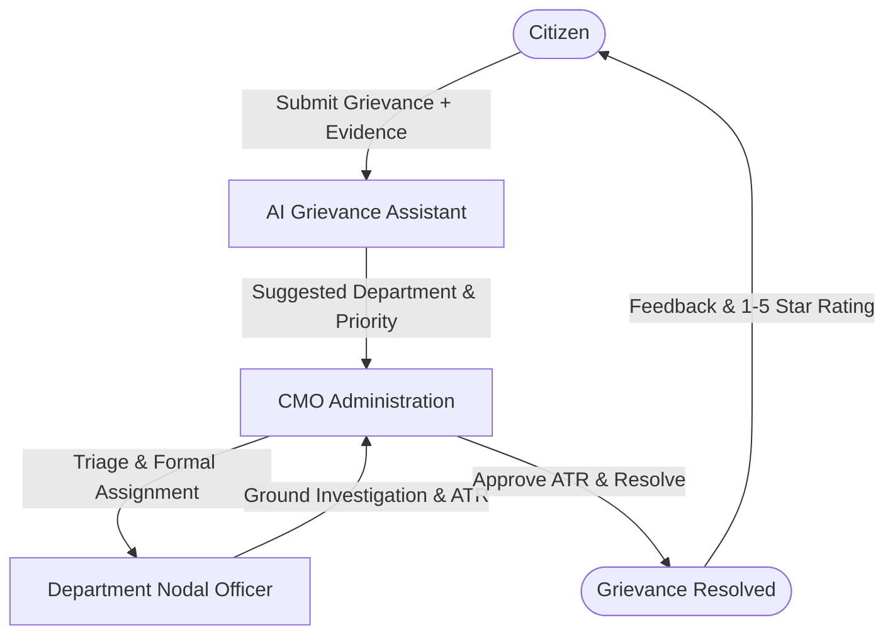

# Janaseva Kerala — Project Overview

> **Chief Minister's Public Grievance Redressal Portal**  
> *A Modern, Transparent, and Accountable Civic Governance Platform*

---

> [!WARNING]
> ### Prototype Evaluation Disclaimer
> **This system is an evaluation prototype developed for WhiteMatrix Software Solutions.**  
> It is **NOT** an official portal, service, or representation of the Government of Kerala, the Chief Minister's Office (CMO), or any statutory department. All names, designations, and government references are utilized strictly for realistic demonstration and architectural evaluation purposes.

---

## 1. Executive Summary

**Janaseva Kerala** is a full-stack, enterprise-grade public grievance redressal portal designed to bridge the gap between citizens and the state government administration. Inspired by modern digital governance frameworks such as the Chief Minister's Public Grievance Redressal Cell (CMPGRC), Janaseva Kerala streamlines how citizens register complaints, track resolution progress in real time, and hold public authorities accountable.

The portal provides an end-to-end workflow covering three distinct operational tiers:
1. **Citizens** who can lodge multi-category complaints, monitor life-cycle milestones with reference numbers (`JK-YYYY-XXXXXX`), upload supporting evidence, and rate redressal quality.
2. **Department Nodal Officers** (PWD, Health, Education, Local Self Government, Water Resources, KSEB, Transport, Revenue) who investigate grievances, post on-the-ground progress updates, and submit formal **Action Taken Reports (ATRs)**.
3. **Chief Minister's Office (CMO) Administrators** who maintain statewide operational oversight, triage incoming petitions, assign nodal departments, log confidential internal remarks, review ATR submissions, enforce Service Level Agreements (SLAs), and analyze statewide performance metrics.

To minimize administrative latency, Janaseva Kerala incorporates an **AI Grievance Assistant** powered by **Google Gemini 1.5 Flash**. The assistant analyzes complaint narratives in real-time, automatically suggesting the appropriate department, complaint category, priority level, and an executive summary. In scenarios where network connectivity or external API access is constrained, a resilient rule-based heuristic fallback engine ensures continuous, zero-downtime operation.

---

## 2. Problem Statement & Civic Challenges

Traditional public grievance systems face significant operational challenges that erode civic trust and create administrative backlogs:

| Traditional Challenge | Janaseva Kerala Solution |
| :--- | :--- |
| **Physical Petition Bottlenecks**<br>Citizens must travel to district collectorates or the state secretariat to submit paper petitions. | **Omnichannel Web Access**<br>Mobile-responsive React SPA accessible 24/7 from any device across Kerala's 14 districts. |
| **Opaque Tracking**<br>Citizens receive no updates after submitting a petition, leading to repeated follow-ups. | **Real-Time Status & Audit Trail**<br>Unique reference tracking (`JK-YYYY-XXXXXX`) with timestamped status history and public tracking without login. |
| **Inter-Departmental Ping-Pong**<br>Complaints are misrouted between departments (e.g., road repair vs underground pipe leakage). | **AI-Powered Triage & CMO Routing**<br>Gemini-driven predictive categorization combined with centralized CMO administrative reassignment. |
| **Lack of Accountability**<br>Complaints are closed without substantive verification or proof of ground resolution. | **Mandatory Action Taken Reports (ATRs)**<br>Officers must upload investigation findings and evidence before CMO review and final resolution. |
| **Absence of Citizen Voice Post-Resolution**<br>Redressal quality is judged solely by internal department metrics. | **Citizen Satisfaction Feedback**<br>Citizens rate resolution quality (1 to 5 stars) and provide post-closure reviews. |

---

## 3. Core Capabilities & Feature Matrix



### 3.1 Citizen Portal
- **Streamlined Authentication**: Email-based signup and JWT authentication with automatic session refresh.
- **Smart Grievance Submission**: Multi-field submission including district, category, subject, detailed description, and document uploads (images/PDFs up to 10MB).
- **AI-Assisted Classification**: Live suggestion pill providing instant recommendations for department, category, and priority before submission.
- **Public & Authenticated Tracking**: Look up grievance progress anytime using the public reference number without requiring sign-in.
- **In-App Notification Center**: Instant visual alerts when grievances change state, get assigned, or receive officer reports.
- **Citizen Feedback System**: Post-resolution satisfaction ratings (1–5 stars) and qualitative commentary to evaluate public service quality.

### 3.2 Department Officer Portal
- **Department-Scoped Workspace**: Officers only see grievances routed specifically to their government department (e.g., PWD, KSEB, Health).
- **Investigation Lifecycle Management**: Update grievance progress from `Submitted` through `Under Review` and `In Progress`.
- **Action Taken Report (ATR) Submission**: Submit formal investigation summaries with supporting photographic or documentary evidence for CMO verification.
- **SLA & Due Date Awareness**: Track pending investigations against targeted redressal due dates to prevent overdue escalation.

### 3.3 CMO Administration Portal
- **Statewide Grievance Command Center**: Monitor aggregate volume, resolution rate, average turnaround time, and pending caseload.
- **Intelligent Triage & Assignment**: Route grievances to any of the 8 state departments and designate specific nodal officers.
- **Confidential Internal Remarks**: Staff-only notes and audit annotations hidden from public and citizen view.
- **ATR Verification Workflow**: Review submitted ATRs with options to **Approve**, **Reject / Re-investigate**, or **Request Revision**.
- **Priority Escalation Matrix**: One-click escalation to `High` or `Urgent` with automated notification dispatches to nodal officers.
- **Statewide Analytics & Visualizations**: Interactive Recharts breakdown of grievances across Kerala's 14 districts, departments, categories, and 6-month historical trends.

### 3.4 Public Transparency Features
- **Public Reference Tracking**: Instant public status check for any grievance reference number (`JK-YYYY-XXXXXX`).
- **Department Directory**: Publicly accessible roster of departments, responsibilities, and official contact emails.
- **Knowledge Base & FAQ**: Interactive accordion answering common citizen questions regarding SLA limits, appeal procedures, and filing rules.
- **Direct Contact & Enquiry Form**: Public inquiry pipeline routing general citizen queries directly to administration staff.

---

## 4. User Personas & Demonstration Profiles

For local evaluation, Janaseva Kerala includes pre-configured demo credentials representing each tier of the administrative hierarchy:

| Role | Demo Email | Demo Password | Persona & Scope |
| :--- | :--- | :--- | :--- |
| **CMO Administrator** | `cmo@janaseva.kerala.gov.in` | `admin123` | **Chief Minister's Office Administrator**<br>Full statewide authority across all 14 districts and 8 departments. Manages triage, internal remarks, ATR approvals, priority escalations, and analytics. |
| **Department Officer** | `officer.pwd@janaseva.kerala.gov.in` | `officer123` | **Er. Rajesh Kumar — PWD Executive Engineer**<br>Departmental investigator for Public Works complaints (roads, bridges, infrastructure). Updates progress and submits ATRs. *(Additional officers available for HLT, EDU, LSG, WRD, KSEB, TRN, REV with password `officer123`)*. |
| **Citizen** | `citizen@example.com` | `citizen123` | **Kavitha R Nair — Resident of Thiruvananthapuram**<br>Standard citizen account. Has submitted sample grievances, tracks petition progress, and submits satisfaction feedback. |

---

## 5. Technology Stack Summary

```
+-----------------------------------------------------------------------------------+
|                                 CLIENT LAYER                                      |
|    React 19  *  Vite 6  *  Tailwind CSS 4  *  React Router 7  *  Recharts 2       |
|    Axios (JWT Interceptors)  *  Lucide React Icons  *  Noto Sans Malayalam Fonts |
+-----------------------------------------------------------------------------------+
                                         │
                             RESTful JSON / HTTPS
                                         ▼
+-----------------------------------------------------------------------------------+
|                              API & APPLICATION LAYER                              |
|   Django 4.2 LTS  *  Django REST Framework (DRF) 3.14  *  SimpleJWT (Blacklist)  |
|   drf-spectacular (OpenAPI 3 / Swagger)  *  django-filter  *  django-cors-headers|
+-----------------------------------------------------------------------------------+
                                         │
                    ┌────────────────────┴────────────────────┐
                    ▼                                         ▼
+---------------------------------------+ +-----------------------------------------+
|           PERSISTENCE LAYER           | |               AI ADVISORY               |
| SQLite (Local Dev) / Neon PostgreSQL  | | Google Gemini 1.5 Flash (Generative AI) |
| WhiteNoise (Static) / Cloudinary Media| | Zero-Downtime Rule-Based Heuristic Eng  |
+---------------------------------------+ +-----------------------------------------+
```

### Backend Specifications
- **Framework**: Django 4.2 LTS (Python 3.12 compatible)
- **API Architecture**: Django REST Framework (DRF) with modular viewsets, generic API views, and serializers
- **Authentication**: JSON Web Tokens (JWT) using `rest_framework_simplejwt` with rotating refresh tokens
- **Documentation**: OpenAPI 3.0 schema generation with interactive Swagger UI and Redoc via `drf-spectacular`
- **Database Support**: Dual-mode engine — zero-setup local SQLite with seamless connection to managed Neon PostgreSQL via `dj-database-url`

### Frontend Specifications
- **Core Library**: React 19 Single Page Application (SPA)
- **Build Tooling**: Vite 6.1 with rapid Hot Module Replacement (HMR)
- **Styling**: Tailwind CSS 4 with custom Kerala civic color palette (Emerald green, Navy blue, Gold accents)
- **Routing**: React Router DOM v7 with role-guarded routes (`ProtectedRoute`)
- **Data Visualization**: Recharts 2 for responsive bar charts, pie charts, and monthly trend graphs
- **Icons & Typography**: Lucide React icons with Google Fonts (Plus Jakarta Sans and Noto Sans Malayalam)

---

## 6. Key Performance Indicators & SLA Targets

Janaseva Kerala enforces administrative service delivery timelines aligned with the Kerala Right to Services Act:

| Grievance Priority | Target Redressal SLA | Escalation Threshold | Target Resolution Rate |
| :--- | :--- | :--- | :--- |
| **Urgent** *(Life safety, live electrical wires)* | 24 to 48 Hours | 48 Hours | 98% |
| **High** *(Water contamination, hospital shortages)* | 5 Business Days | 7 Days | 95% |
| **Medium** *(Potholes, streetlights, drainage)* | 14 Business Days | 15 Days | 90% |
| **Low** *(General inquiries, certificate delays)* | 30 Calendar Days | 30 Days | 85% |

---

## 7. Documentation Roadmap

This documentation suite provides complete coverage of Janaseva Kerala's architecture, APIs, database, and operations:

- [01 Project Overview](file:///c:/Users/HP/.gemini/antigravity/scratch/janaseva-kerala/DOCUMENTATION/01_Project_Overview.md) — Executive summary, civic context, feature matrix, and tech stack.
- [02 System Architecture](file:///c:/Users/HP/.gemini/antigravity/scratch/janaseva-kerala/DOCUMENTATION/02_System_Architecture.md) — Layered architecture, component responsibilities, data flow sequence diagrams, and security model.
- [03 Database Design](file:///c:/Users/HP/.gemini/antigravity/scratch/janaseva-kerala/DOCUMENTATION/03_Database_Design.md) — Comprehensive ER diagram, schema tables, indexes, constraints, and audit trails.
- [04 API Documentation](file:///c:/Users/HP/.gemini/antigravity/scratch/janaseva-kerala/DOCUMENTATION/04_API_Documentation.md) — Complete REST endpoint reference with request/response payloads and status codes.
- [05 AI Integration](file:///c:/Users/HP/.gemini/antigravity/scratch/janaseva-kerala/DOCUMENTATION/05_AI_Integration.md) — Google Gemini 1.5 Flash implementation, prompt structure, heuristic fallback engine, and safeguards.
- [06 Setup and Testing](file:///c:/Users/HP/.gemini/antigravity/scratch/janaseva-kerala/DOCUMENTATION/06_Setup_and_Testing.md) — Step-by-step developer installation, environment variables, seeding commands, and 67 automated test suites.
- [07 User Guide](file:///c:/Users/HP/.gemini/antigravity/scratch/janaseva-kerala/DOCUMENTATION/07_User_Guide.md) — Role-based operational manual for Citizens, Department Officers, and CMO Administrators.
- [Root README](file:///c:/Users/HP/.gemini/antigravity/scratch/janaseva-kerala/README.md) — Project summary, quick-start guide, demo credentials, and navigation index.
