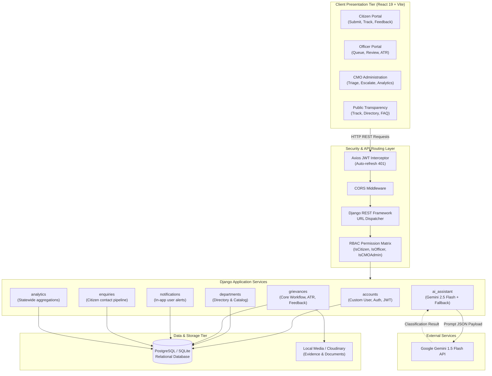
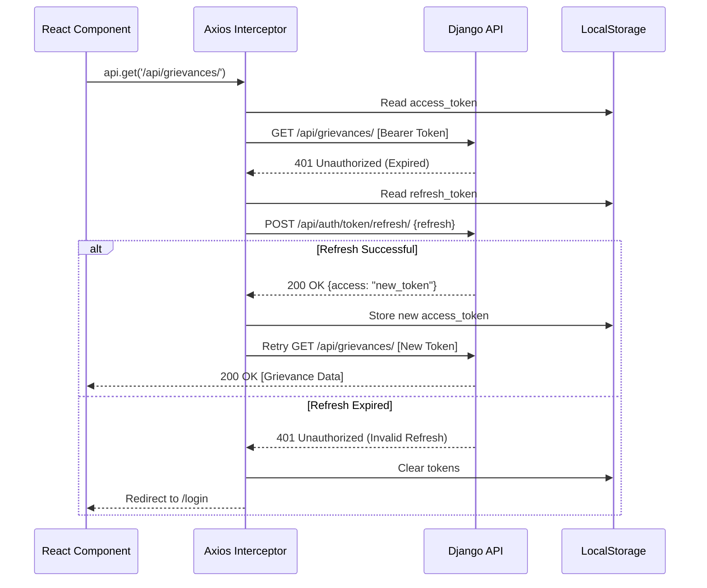
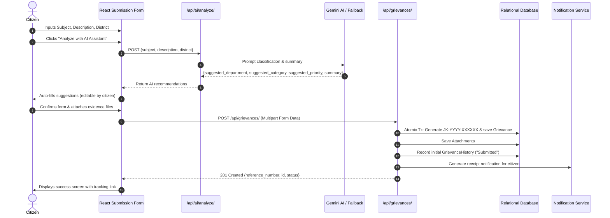
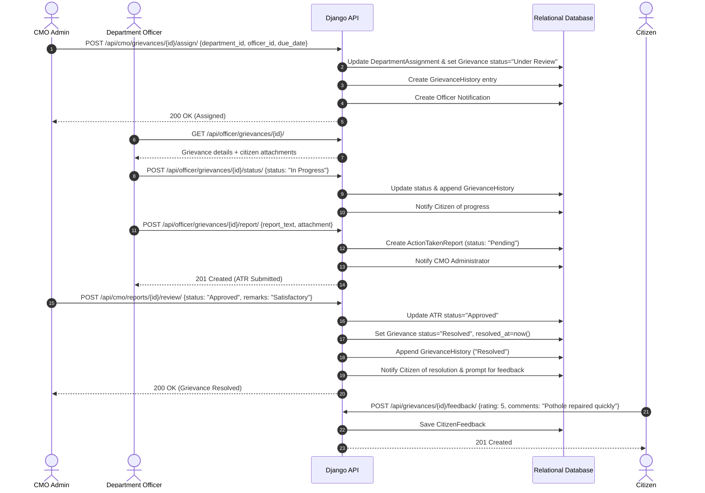
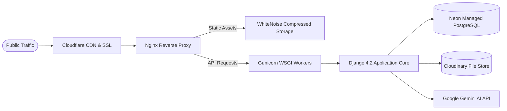

# Janaseva Kerala — System Architecture

> **Technical Architecture, Component Design, and Security Specifications**  
> *Chief Minister's Public Grievance Redressal Portal*

---

> [!WARNING]
> ### Prototype Evaluation Disclaimer
> **This system is an evaluation prototype developed for WhiteMatrix Software Solutions.**  
> It is **NOT** an official platform of the Government of Kerala. All architectural choices and workflows represent an enterprise reference implementation.

---

## 1. Architectural Philosophy & Overview

Janaseva Kerala is built upon a **decoupled, multi-tier client-server architecture**. The frontend is engineered as a high-performance **Single Page Application (SPA)** using **React 19** and **Vite**, communicating strictly via JSON over REST with a robust **Django 4.2 LTS** and **Django REST Framework (DRF)** backend.

```
┌────────────────────────────────────────────────────────────────────────┐
│                        PRESENTATION TIER                               │
│  React 19 SPA * React Router v7 * Tailwind CSS 4 * Recharts * Axios    │
└───────────────────────────────────┬────────────────────────────────────┘
                                    │ JSON / REST (Bearer JWT)
                                    ▼
┌────────────────────────────────────────────────────────────────────────┐
│                      SECURITY & GATEWAY LAYER                          │
│  CORS Middleware * SimpleJWT Authentication * Custom RBAC Permissions  │
└───────────────────────────────────┬────────────────────────────────────┘
                                    │
                                    ▼
┌────────────────────────────────────────────────────────────────────────┐
│                      APPLICATION CORE (DJANGO)                         │
│  apps.accounts      apps.departments     apps.grievances               │
│  apps.ai_assistant  apps.notifications   apps.enquiries apps.analytics │
└──────────────────┬────────────────────────────────┬────────────────────┘
                   │                                │
                   ▼                                ▼
┌──────────────────────────────────────┐ ┌───────────────────────────────┐
│          PERSISTENCE LAYER           │ │        AI ADVISORY CORE       │
│  Neon PostgreSQL / SQLite (Local)    │ │  Google Gemini 2.5 Flash      │
│  Django ORM with Atomic Transactions │ │  Heuristic Rule-Based Fallback│
└──────────────────────────────────────┘ └───────────────────────────────┘
```

The design emphasizes:
- **Strict Separation of Concerns**: The backend serves strictly as a stateless API gateway with no HTML rendering for core business flows.
- **Role-Based Access Control (RBAC)**: Enforced both on the client (route-guarding components) and at the API level (custom DRF permission classes).
- **Graceful Degradation**: External dependencies (such as Google Gemini AI or Cloudinary media storage) operate behind defensive fallback abstractions to guarantee 100% uptime.
- **Auditability**: Every status transition, departmental reassignment, and administrative remark creates an immutable record in audit models (`GrievanceHistory`, `InternalRemark`).

---

## 2. High-Level Architecture Diagram



---

## 3. Frontend Architecture

The frontend is constructed using a modern React 19 architecture structured around domain modules, contextual state, and unified API clients:

```
frontend/src/
├── api/                  # Modular Axios API service abstractions
│   ├── axios.js          # Base client with auth token & 401 refresh interceptors
│   ├── auth.js           # Login, register, logout, profile endpoints
│   ├── grievances.js     # Citizen grievance CRUD, tracking, and feedback
│   ├── cmo.js            # CMO triage, assignment, remark, and ATR reviews
│   ├── officer.js        # Officer queue, status progression, and ATR submission
│   └── misc.js           # Departments, notifications, contact, and AI endpoints
├── components/           # Reusable UI building blocks
│   ├── common/           # StatusBadge, PriorityBadge, LoadingSpinner, ProtectedRoute
│   └── layout/           # Navbar, Footer, Sidebar, DashboardLayout, PublicLayout
├── contexts/             # Global application state
│   └── AuthContext.jsx   # Current user, authentication state, login/logout handlers
├── pages/                # Screen-level route views
│   ├── auth/             # LoginPage, RegisterPage
│   ├── citizen/          # CitizenDashboard, SubmitGrievancePage, GrievanceListPage, GrievanceDetailPage, NotificationsPage
│   ├── cmo/              # CMODashboard, CMOGrievanceList, CMOGrievanceDetail, AnalyticsPage
│   ├── officer/          # OfficerDashboard, OfficerGrievanceList, OfficerGrievanceDetail
│   └── public/           # HomePage, AboutPage, HowItWorksPage, DepartmentsPage, ContactPage, FAQPage, TrackGrievancePage
├── App.jsx               # React Router 7 declarative routing matrix
├── index.css             # Tailwind CSS 4 setup and color tokens
└── main.jsx              # React root entrypoint
```

### 3.1 Authentication & Axios Interceptor Pipeline
- **Token Persistence**: Tokens are stored in browser `localStorage` under `access_token` and `refresh_token`.
- **Request Interceptor**: Automatically attaches `Authorization: Bearer <access_token>` to every outbound HTTP call.
- **Response Interceptor (401 Handling)**:
  1. Intercepts `401 Unauthorized` responses.
  2. Queues parallel requests while requesting a new access token via `/api/auth/token/refresh/`.
  3. Re-dispatches original requests transparently upon receiving new credentials.
  4. If the refresh token has expired or is blacklisted, gracefully flushes credentials and redirects to `/login`.



### 3.2 Role-Guarded Navigation (`ProtectedRoute`)
React Router paths are shielded by a custom `ProtectedRoute` component that evaluates:
1. **Authentication status**: Verifies whether an authenticated session exists; redirects unauthenticated users to `/login`.
2. **Role matching**: Ensures the user's role (`citizen`, `officer`, `cmo_admin`) matches the route's permission profile. Non-matching users are redirected to their authorized dashboard.

---

## 4. Backend Application Architecture

The Django backend is segmented into 7 modular domain applications within `backend/apps/`:

### 4.1 `apps.accounts`
- **Custom User Model**: `User` inherits from `AbstractBaseUser` and `PermissionsMixin`.
- **Email-As-Username**: Utilizes unique `email` for all authentication (passwords hashed using PBKDF2 with SHA256).
- **Role TextChoices**: `citizen`, `cmo_admin`, `officer`.
- **Department Association**: Foreign key linking `officer` accounts to their respective `Department`.

### 4.2 `apps.departments`
- **Department Catalog**: Manages Kerala government departments (`PWD`, `HLT`, `EDU`, `LSG`, `WRD`, `KSEB`, `TRN`, `REV`).
- **Access Policy**: Read operations are publicly accessible (`AllowAny`); modifications are restricted to `IsCMOAdmin`.

### 4.3 `apps.grievances`
- **Core Life Cycle**: Enforces state machines for grievances (`Submitted` → `Under Review` → `In Progress` → `Resolved` / `Reopened`).
- **Sequential Ref Number**: Atomic transaction generator yielding `JK-YYYY-XXXXXX`.
- **Audit Trails**: Automatically logs state changes to `GrievanceHistory`.
- **Department Assignment**: Tracks routing to departments and nodal officers with assignment notes.
- **Action Taken Report (ATR)**: Formal investigation report submitted by officers, reviewed by CMO admins.
- **Citizen Feedback**: Single 1–5 star rating and comment per resolved grievance.
- **Internal Remarks**: Confidential notes added by CMO administrators.

### 4.4 `apps.ai_assistant`
- **Advisory Service**: `GeminiService` encapsulates communication with Google Gemini 2.5 Flash via modern `google-genai` SDK.
- **Schema Enforcement**: Requests strictly structured JSON output for summary, department, category, priority, and reasoning.
- **Database Validation**: Validates predictions against active departments and categories in PostgreSQL.
- **Defensive Fallback**: Full keyword-matching heuristic engine that takes over if API credentials are unavailable, rate-limited, or network is offline.

### 4.5 `apps.notifications`
- **In-App Messaging**: Generates targeted alerts for citizens (e.g. status updates) and officers (e.g. new assignments).
- **State Tracking**: Unread/read status tracking with bulk mark-all-read capabilities.

### 4.6 `apps.enquiries`
- **Public Pipeline**: Handles general citizen contact inquiries submitted through the public portal.

### 4.7 `apps.analytics`
- **Statewide Aggregation**: Aggregates complaint volume across districts, categories, departments, and monthly trends using Django ORM aggregation expressions (`Count`, `Avg`, `TruncMonth`).

---

## 5. End-to-End Data Flow Workflows

### 5.1 Citizen Grievance Submission with AI Advisory


### 5.2 CMO Assignment, Officer Investigation, and ATR Approval


---

## 6. Security & Authorization Architecture

### 6.1 Role-Based Permissions Matrix
Permissions are strictly validated at the DRF view level before query execution:

| API Namespace | Citizen | Department Officer | CMO Administrator | Unauthenticated |
| :--- | :---: | :---: | :---: | :---: |
| `/api/auth/register/` | Allowed | Allowed | Allowed | Allowed |
| `/api/auth/login/` | Allowed | Allowed | Allowed | Allowed |
| `/api/auth/me/` | Own Profile | Own Profile | Own Profile | Forbidden |
| `/api/departments/` [GET] | Allowed | Allowed | Allowed | Allowed |
| `/api/departments/` [POST/PUT/DEL] | Forbidden | Forbidden | Allowed | Forbidden |
| `/api/grievances/` [GET] | Own Grievances | Forbidden | Forbidden | Forbidden |
| `/api/grievances/` [POST] | Allowed | Forbidden | Forbidden | Forbidden |
| `/api/grievances/track/` | Allowed | Allowed | Allowed | Allowed |
| `/api/cmo/officers/*` | Forbidden | Forbidden | Full Access | Forbidden |
| `/api/cmo/*` | Forbidden | Forbidden | Full Access | Forbidden |
| `/api/officer/*` | Forbidden | Department Scope | Forbidden | Forbidden |
| `/api/analytics/*` | Forbidden | Forbidden | Full Access | Forbidden |

### 6.2 Token Security
- **Access Token**: Short-lived (2 hours) to minimize exposure windows.
- **Refresh Token**: 7-day lifetime with automatic rotation (`ROTATE_REFRESH_TOKENS = True`) and immediate blacklisting of used refresh tokens (`BLACKLIST_AFTER_ROTATION = True`).
- **Signature Algorithm**: HMAC-SHA256 keyed to a dedicated server environment secret.

### 6.3 Data Sanitization & Defensive Design
- **SQL Injection Prevention**: All queries utilize Django's parameterized Object-Relational Mapper (ORM). Raw SQL is strictly disallowed.
- **File Upload Safeguards**: Uploads are restricted by extension (PDF, JPG, JPEG, PNG, WEBP) and validated for size limits (maximum 10MB) to protect against denial-of-service and remote execution.
- **Cross-Origin Resource Sharing (CORS)**: Strict origin whitelisting via `django-cors-headers`. Defaults to `http://localhost:5173` and `http://127.0.0.1:5173` for development.
- **Confidential Information Shielding**: Internal remarks (`InternalRemark`) and administrative notes are excluded from Citizen and Public serializers.

---

## 7. Production Deployment & Scalability Architecture



- **Static Asset Serving**: Integrated `WhiteNoise` compression with unique content hashing eliminates static file bottlenecks.
- **Database Scalability**: Fully compatible with serverless **Neon PostgreSQL** via `dj-database-url` with connection pooling (`conn_max_age=600`).
- **Horizontal Scaling**: Stateless backend design allows effortless scaling across multiple containerized Gunicorn/Uvicorn instances behind a standard load balancer.
