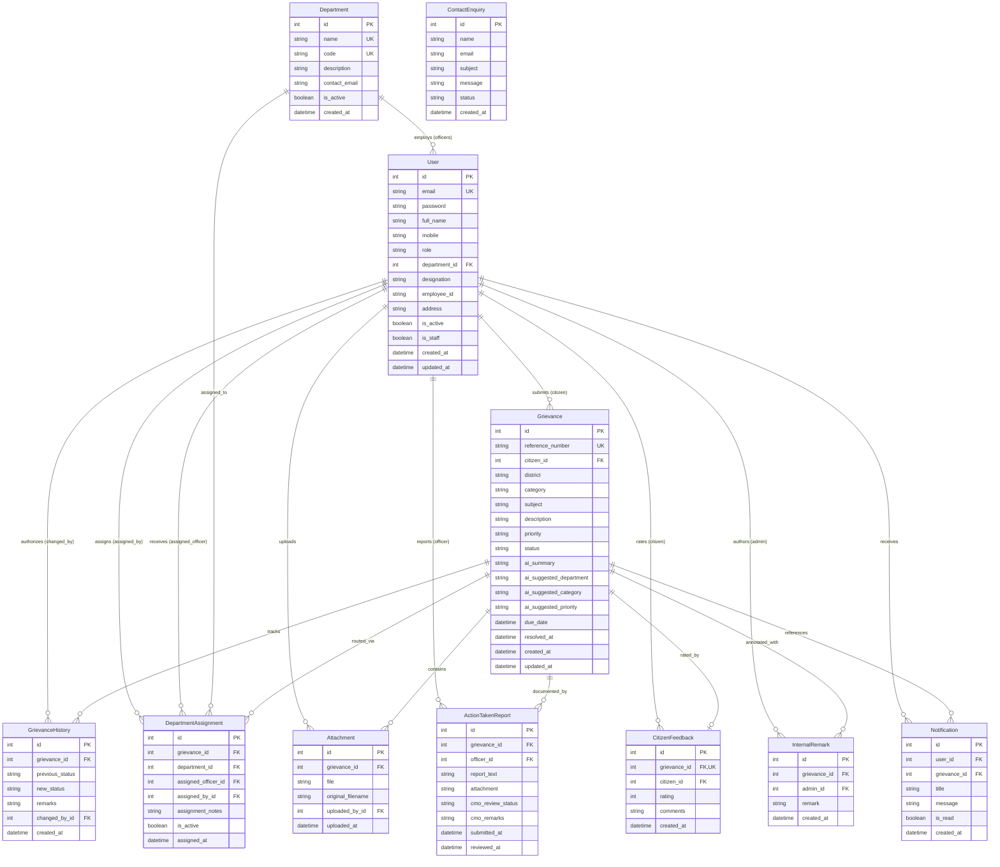

# Janaseva Kerala — Database Design & Schema Specification

> **Relational Data Modeling, Entity Relationships, Constraints, and Indexing**  
> *Chief Minister's Public Grievance Redressal Portal*

---

> [!WARNING]
> ### Prototype Evaluation Disclaimer
> **This system is an evaluation prototype developed for WhiteMatrix Software Solutions.**  
> It is **NOT** an official database schema or government registry of the Government of Kerala.

---

## 1. Database Architecture & Design Principles

The database schema of **Janaseva Kerala** is structured around standard relational principles (3rd Normal Form) to guarantee **strict referential integrity**, **tamper-evident auditability**, and **high-throughput retrieval**.

Key design tenets:
- **Comprehensive Audit Trails**: State transitions are never merely overwritten in place; every movement is recorded in `GrievanceHistory` with the actor's identity, timestamps, and remarks.
- **Role-Centric Access**: User accounts decouple citizens, administrative executives, and departmental nodal officers through unified role attributes and departmental foreign keys.
- **Concurrency-Safe Key Generation**: Human-readable reference numbers (`JK-YYYY-XXXXXX`) are minted within row-level locked atomic transactions to eliminate collision risk in multi-worker environments.
- **Compound Query Indexing**: Optimized for analytical rollups and frequent dashboard filtering across status, priority, district, and category.

---

## 2. Complete Entity-Relationship (ER) Diagram



---

## 3. Enumerations & Allowed Choices

### 3.1 District Choices (`District`)
Covering all 14 administrative revenue districts of Kerala:
- `Alappuzha`, `Ernakulam`, `Idukki`, `Kannur`, `Kasaragod`, `Kollam`, `Kottayam`, `Kozhikode`, `Malappuram`, `Palakkad`, `Pathanamthitta`, `Thiruvananthapuram`, `Thrissur`, `Wayanad`.

### 3.2 Grievance Category Choices (`GrievanceCategory`)
Standardized civic classification domains:
- `Public Works` — Roads, bridges, footpaths, government buildings.
- `Healthcare` — Hospitals, primary health centres, medicine availability, sanitation.
- `Education` — Schools, colleges, teacher allocation, midday meals.
- `Local Self Government` — Grama panchayats, municipalities, waste management, streetlights.
- `Water Resources` — Drinking water pipelines, irrigation, Kerala Water Authority (KWA).
- `Electricity` — Power outages, transformer issues, billing, KSEB line hazards.
- `Transport` — KSRTC buses, traffic signals, motor vehicles department (MVD).
- `Revenue & Land` — Land records, mutations, village offices, certificates.
- `Law & Order` — Police administration, public safety, law enforcement.
- `Civil Supplies` — Ration cards, fair price shops, consumer food grain distribution.
- `Environment` — Pollution, forest conservation, river sand mining.
- `Other` — Miscellaneous public grievances.

### 3.3 Priority Levels (`GrievancePriority`)
- `Low` (30 days SLA): General suggestions, non-urgent inquiries.
- `Medium` (14 days SLA): Standard civic defects (e.g. minor road defects, billing doubts).
- `High` (5 days SLA): Significant civic disruptions (water supply outages, school building damages).
- `Urgent` (24–48 hours SLA): Life-safety hazards (live snapped electrical cables, hospital medical emergencies, bridge collapses).

### 3.4 Grievance Statuses (`GrievanceStatus`)
- `Submitted`: Initial submission received from citizen, pending CMO triage.
- `Under Review`: Assigned to department; nodal officer examining file.
- `In Progress`: Ground field work or formal investigation underway.
- `Resolved`: Redressal completed, Action Taken Report verified and approved by CMO.
- `Reopened`: Citizen requested reconsideration due to incomplete or defective redressal.

### 3.5 User Roles (`User.Role`)
- `citizen`: General public filer.
- `officer`: Departmental nodal investigator.
- `cmo_admin`: Executive administrator in Chief Minister's Office.

---

## 4. Detailed Table Schema Definitions

### 4.1 `accounts_user`
Stores system accounts for all three user roles. Uses email as unique username.

| Field Name | Type | Constraints | Description |
| :--- | :--- | :--- | :--- |
| `id` | BigAutoField | PK, Auto-increment | Unique identifier |
| `email` | EmailField(254) | Unique, db_index | Primary login credential |
| `password` | CharField(128) | Not Null | PBKDF2 SHA-256 hashed password |
| `full_name` | CharField(150) | Not Null | Official display name |
| `mobile` | CharField(20) | Blank=True, Default="" | Contact telephone number |
| `role` | CharField(20) | db_index, Default="citizen" | Role enum: citizen / cmo_admin / officer |
| `department_id` | ForeignKey | Nullable, SET_NULL | Assigned department (for officers only) |
| `designation` | CharField(150) | Blank=True, Default="" | Official designation (for officers) |
| `employee_id` | CharField(50) | Blank=True, Default="" | Departmental employee ID (for officers) |
| `address` | TextField | Blank=True, Default="" | Residential / communication address (for citizens) |
| `is_active` | BooleanField | Default=True | Login activation toggle |
| `is_staff` | BooleanField | Default=False | Django admin permission |
| `is_superuser` | BooleanField | Default=False | Super administrator status |
| `created_at` | DateTimeField | auto_now_add=True | Timestamp of registration |
| `updated_at` | DateTimeField | auto_now=True | Timestamp of last profile update |

---

### 4.2 `departments_department`
Government departments responsible for investigating and redressing citizen complaints.

| Field Name | Type | Constraints | Description |
| :--- | :--- | :--- | :--- |
| `id` | BigAutoField | PK, Auto-increment | Unique identifier |
| `name` | CharField(150) | Unique | Formal name (e.g. Public Works Department) |
| `code` | CharField(30) | Unique, db_index | Short departmental code (e.g. PWD, KSEB) |
| `description` | TextField | Blank=True | Scope and operational mandate |
| `contact_email` | EmailField(254) | Not Null | Official nodal email address |
| `is_active` | BooleanField | Default=True | Status toggle |
| `created_at` | DateTimeField | auto_now_add=True | Registration timestamp |

---

### 4.3 `grievances_grievance`
Central entity representing citizen grievances submitted to the CMO.

| Field Name | Type | Constraints | Description |
| :--- | :--- | :--- | :--- |
| `id` | BigAutoField | PK, Auto-increment | Internal database primary key |
| `reference_number` | CharField(30) | Unique, db_index, Non-editable | Human tracking code (`JK-YYYY-XXXXXX`) |
| `citizen_id` | ForeignKey | CASCADE, `accounts_user` | Citizen account filing the petition |
| `district` | CharField(60) | db_index, District choices | One of Kerala's 14 revenue districts |
| `category` | CharField(60) | db_index, Category choices | Functional governance category |
| `subject` | CharField(255) | Not Null | Concise title of the grievance |
| `description` | TextField | Not Null | Full factual statement of complaint |
| `priority` | CharField(20) | db_index, Default="Medium" | Urgency level (Low/Medium/High/Urgent) |
| `status` | CharField(20) | db_index, Default="Submitted" | Workflow state |
| `ai_summary` | TextField | Nullable, Blank=True | Gemini-generated executive summary |
| `ai_suggested_department` | CharField(150) | Nullable, Blank=True | Gemini recommended department |
| `ai_suggested_category` | CharField(100) | Nullable, Blank=True | Gemini recommended category |
| `ai_suggested_priority` | CharField(50) | Nullable, Blank=True | Gemini recommended priority |
| `due_date` | DateTimeField | Nullable, Blank=True | Targeted SLA resolution deadline |
| `resolved_at` | DateTimeField | Nullable, Blank=True | Actual timestamp when marked Resolved |
| `created_at` | DateTimeField | auto_now_add=True, db_index | Submission timestamp |
| `updated_at` | DateTimeField | auto_now=True | Last modification timestamp |

---

### 4.4 `grievances_grievancehistory`
Immutable event log recording every status change for audit compliance.

| Field Name | Type | Constraints | Description |
| :--- | :--- | :--- | :--- |
| `id` | BigAutoField | PK, Auto-increment | Unique identifier |
| `grievance_id` | ForeignKey | CASCADE, `grievances_grievance` | Parent grievance record |
| `previous_status` | CharField(50) | Not Null | Prior status state string |
| `new_status` | CharField(50) | Not Null | Resulting status state string |
| `remarks` | TextField | Blank=True, Default="" | Officer or admin narrative explanation |
| `changed_by_id` | ForeignKey | Nullable, SET_NULL, `accounts_user` | User who authorized the state update |
| `created_at` | DateTimeField | auto_now_add=True | Exact timestamp of change |

---

### 4.5 `grievances_departmentassignment`
Tracks routing of grievances to departments and assigned nodal officers.

| Field Name | Type | Constraints | Description |
| :--- | :--- | :--- | :--- |
| `id` | BigAutoField | PK, Auto-increment | Unique identifier |
| `grievance_id` | ForeignKey | CASCADE, `grievances_grievance` | Target grievance |
| `department_id` | ForeignKey | CASCADE, `departments_department` | Assigned department entity |
| `assigned_officer_id` | ForeignKey | Nullable, SET_NULL, `accounts_user` | Designated investigator |
| `assigned_by_id` | ForeignKey | CASCADE, `accounts_user` | CMO Administrator issuing routing |
| `assignment_notes` | TextField | Blank=True, Default="" | Administrative triage instructions |
| `assigned_at` | DateTimeField | auto_now_add=True | Routing timestamp |
| `is_active` | BooleanField | Default=True | Active flag (False if reassigned) |

---

### 4.6 `grievances_attachment`
Supporting evidence files (photographs, medical slips, receipts, site scans) uploaded by citizens or officials.

| Field Name | Type | Constraints | Description |
| :--- | :--- | :--- | :--- |
| `id` | BigAutoField | PK, Auto-increment | Unique identifier |
| `grievance_id` | ForeignKey | CASCADE, `grievances_grievance` | Related grievance |
| `file` | FileField | upload_to='grievance_attachments/' | Path or Cloudinary URL |
| `original_filename` | CharField(255) | Not Null | Original name of uploaded file |
| `uploaded_by_id` | ForeignKey | CASCADE, `accounts_user` | Account uploading the document |
| `uploaded_at` | DateTimeField | auto_now_add=True | Upload timestamp |

---

### 4.7 `grievances_actiontakenreport`
Formal investigation report drafted by field officers and scrutinized by the CMO.

| Field Name | Type | Constraints | Description |
| :--- | :--- | :--- | :--- |
| `id` | BigAutoField | PK, Auto-increment | Unique identifier |
| `grievance_id` | ForeignKey | CASCADE, `grievances_grievance` | Related grievance |
| `officer_id` | ForeignKey | CASCADE, `accounts_user` | Reporting officer |
| `report_text` | TextField | Not Null | Substantive findings and actions taken |
| `attachment` | FileField | Nullable, upload_to='action_reports/' | Official completion certificate / photos |
| `cmo_review_status` | CharField(30) | ReviewStatus choices, Default="Pending" | Pending / Approved / Rejected / Revision Requested |
| `cmo_remarks` | TextField | Blank=True, Default="" | Scrutiny remarks from CMO reviewer |
| `submitted_at` | DateTimeField | auto_now_add=True | Submission timestamp |
| `reviewed_at` | DateTimeField | Nullable, Blank=True | CMO verification timestamp |

---

### 4.8 `grievances_citizenfeedback`
Citizen satisfaction evaluation upon completion of redressal.

| Field Name | Type | Constraints | Description |
| :--- | :--- | :--- | :--- |
| `id` | BigAutoField | PK, Auto-increment | Unique identifier |
| `grievance_id` | OneToOneField | CASCADE, Unique | Enforces exactly one feedback per complaint |
| `citizen_id` | ForeignKey | CASCADE, `accounts_user` | Citizen submitting the rating |
| `rating` | PositiveSmallIntegerField | Not Null, Range 1–5 | Numeric rating score |
| `comments` | TextField | Blank=True, Default="" | Citizen qualitative comments |
| `created_at` | DateTimeField | auto_now_add=True | Submission timestamp |

---

### 4.9 `grievances_internalremark`
Confidential operational notes visible exclusively to CMO staff.

| Field Name | Type | Constraints | Description |
| :--- | :--- | :--- | :--- |
| `id` | BigAutoField | PK, Auto-increment | Unique identifier |
| `grievance_id` | ForeignKey | CASCADE, `grievances_grievance` | Related grievance |
| `admin_id` | ForeignKey | CASCADE, `accounts_user` | CMO Administrator posting remark |
| `remark` | TextField | Not Null | Confidential note content |
| `created_at` | DateTimeField | auto_now_add=True | Entry timestamp |

---

### 4.10 `notifications_notification`
In-app communication records delivering alerts to citizens, officers, and administrators.

| Field Name | Type | Constraints | Description |
| :--- | :--- | :--- | :--- |
| `id` | BigAutoField | PK, Auto-increment | Unique identifier |
| `user_id` | ForeignKey | CASCADE, `accounts_user` | Recipient user |
| `title` | CharField(255) | Not Null | Alert header |
| `message` | TextField | Not Null | Descriptive notification content |
| `grievance_id` | ForeignKey | Nullable, SET_NULL | Associated grievance reference |
| `is_read` | BooleanField | Default=False, db_index | Unread/read status |
| `created_at` | DateTimeField | auto_now_add=True, db_index | Timestamp of creation |

---

### 4.11 `enquiries_contactenquiry`
General citizen inquiries received from the public website contact form.

| Field Name | Type | Constraints | Description |
| :--- | :--- | :--- | :--- |
| `id` | BigAutoField | PK, Auto-increment | Unique identifier |
| `name` | CharField(150) | Not Null | Citizen full name |
| `email` | EmailField(254) | Not Null | Citizen email address |
| `subject` | CharField(255) | Not Null | Inquiry subject |
| `message` | TextField | Not Null | Citizen message body |
| `status` | CharField(20) | db_index, Default="New" | New / Responded / Archived |
| `created_at` | DateTimeField | auto_now_add=True, db_index | Submission timestamp |

---

## 5. Reference Number Generation Logic

Every grievance receives a unique human-friendly identifier adhering to the format:
$$\text{JK}-\text{YYYY}-\text{XXXXXX}$$
*(e.g., `JK-2026-000001` for the first grievance in 2026).*

To prevent race conditions during concurrent submissions across multiple Gunicorn workers, the generator employs a database transaction lock (`select_for_update()`):

```python
def generate_reference_number():
    """Generate unique human-readable grievance reference number: JK-YYYY-XXXXXX."""
    current_year = datetime.datetime.now().year
    prefix = f"JK-{current_year}-"
    
    with transaction.atomic():
        last_grievance = Grievance.objects.filter(
            reference_number__startswith=prefix
        ).order_by('-reference_number').select_for_update().first()

        if last_grievance and last_grievance.reference_number:
            try:
                last_seq = int(last_grievance.reference_number.split('-')[-1])
                new_seq = last_seq + 1
            except (ValueError, IndexError):
                new_seq = Grievance.objects.filter(reference_number__startswith=prefix).count() + 1
        else:
            new_seq = 1

        ref_number = f"{prefix}{new_seq:06d}"
        
        # Absolute uniqueness fallback
        while Grievance.objects.filter(reference_number=ref_number).exists():
            new_seq += 1
            ref_number = f"{prefix}{new_seq:06d}"

        return ref_number
```

---

## 6. Indexing & Query Optimization Strategy

To maintain sub-50ms API response times across high volume, the schema defines strategic indexes:

```python
class Meta:
    indexes = [
        # Optimized for CMO Dashboard status and urgency breakdowns
        models.Index(fields=['status', 'priority']),
        # Optimized for geographical and functional analytics rollups
        models.Index(fields=['district', 'category']),
        # Optimized for reverse chronological pagination
        models.Index(fields=['created_at']),
    ]
```

- **Compound Index `['status', 'priority']`**: Enables index-only scans when computing the CMO dashboard counters and urgency flags.
- **Compound Index `['district', 'category']`**: Accelerates statewide geographical aggregation queries.
- **Single Index `created_at`**: Eliminates sorting overhead on large table scans during paginated retrieval.
- **Single Index `is_read` on Notifications**: Delivers sub-millisecond retrieval of unread notification badge counts (`/api/notifications/unread-count/`).
