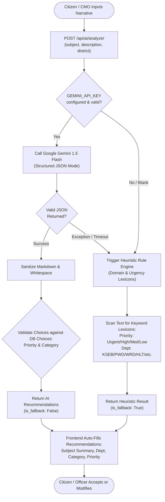
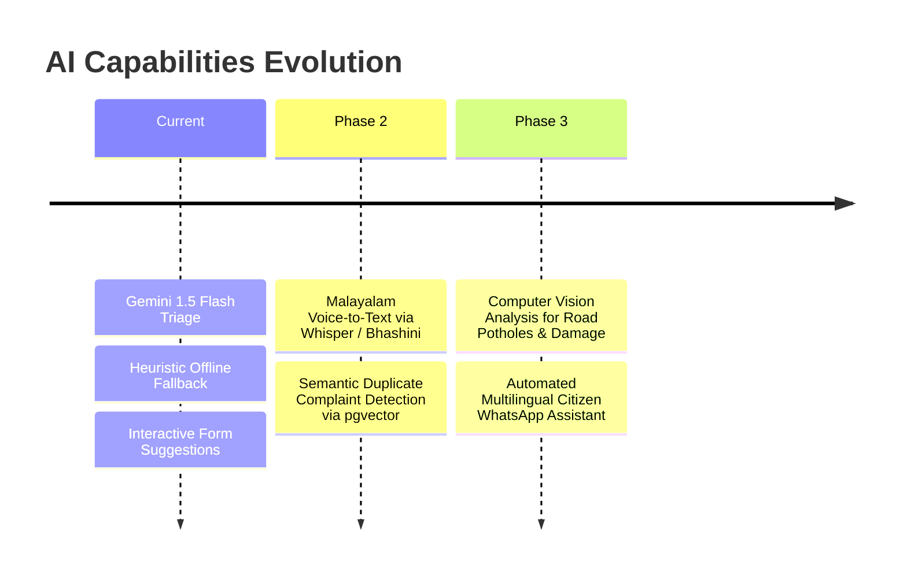

# Janaseva Kerala — AI Integration & Grievance Triage Assistant

> **Advisory AI Architecture, Google Gemini 1.5 Flash Implementation, and Resilient Fallback Engine**  
> *Chief Minister's Public Grievance Redressal Portal*

---

> [!WARNING]
> ### Prototype Evaluation Disclaimer
> **This system is an evaluation prototype developed for WhiteMatrix Software Solutions.**  
> It is **NOT** an official AI advisory system of the Government of Kerala. All AI models, classifications, and heuristics are intended for evaluation purposes.

---

## 1. AI Integration Philosophy

The AI Grievance Assistant in **Janaseva Kerala** is designed with a strict **Human-in-the-Loop Advisory** philosophy. In public sector governance, autonomous automated decision-making without administrative review introduces significant risks of misrouting, bias, or administrative negligence.

### Core Principles
1. **Advisory, Not Decisional**: The AI assistant never makes final or irrevocable routing decisions. It offers real-time recommendations to the citizen during drafting and provides suggestions to CMO triage officers.
2. **Zero-Downtime Resilience**: External LLM API rate limits, network outages, or missing credentials must never block grievance submission. The system implements a deterministic, rule-based heuristic fallback engine.
3. **Data Privacy & Minimal Exposure**: Only the grievance narrative (`subject`, `description`, and `district`) is passed to the AI model. Personal Identifying Information (PII) such as citizen phone numbers, email addresses, or physical street addresses are strictly excluded from AI prompts.
4. **Explainable Recommendations**: Every prediction returned by the assistant includes an explicit `reasoning` justification explaining why a specific department, category, or priority was recommended.

---

## 2. AI Architecture & Execution Pipeline



---

## 3. Google Gemini 1.5 Flash Integration

### 3.1 Model Selection
Janaseva Kerala utilizes **Google Gemini 1.5 Flash** (`gemini-1.5-flash`) via the `google-generativeai` SDK. Gemini 1.5 Flash is selected for:
- **Low Latency**: Sub-second round-trip time suitable for interactive frontend auto-suggestions.
- **Native JSON Generation**: Strict adherence to application JSON schemas via `generation_config={"response_mime_type": "application/json"}`.
- **Superior Contextual Reasoning**: Accurate understanding of civic terminology, local Kerala administrative references (e.g. *KSEB, KWA, Panchayats, LSGD*), and multilingual nuance.

### 3.2 System Prompt Design
The service constructs an authoritative prompt instructing the model to act as an expert government triage assistant:

```python
prompt = f"""You are an expert grievance triage assistant for Janaseva Kerala (Chief Minister's Public Grievance Redressal System, Government of Kerala).
Analyze the following citizen complaint and provide classification recommendations:
- Subject: {subject}
- Description: {description}
- District: {district if district else 'Not specified'}

Return a single JSON object with the following keys:
1. "summary": A concise 1-2 sentence executive summary of the issue.
2. "suggested_department": The most appropriate Kerala Government department (e.g. Public Works Department, Health and Family Welfare Department, General Education Department, Local Self Government Department, Water Resources Department, Kerala State Electricity Board, Transport Department, Revenue Department, Home Department).
3. "suggested_category": One of the exact categories: ["Public Works", "Healthcare", "Education", "Local Self Government", "Water Resources", "Electricity", "Transport", "Revenue & Land", "Law & Order", "Civil Supplies", "Environment", "Other"].
4. "suggested_priority": Exactly one priority level: ["Low", "Medium", "High", "Urgent"]. (Use Urgent only for severe life-safety emergencies, immediate public hazards, or critical disasters).
5. "reasoning": A brief 1-2 sentence rationale for the recommended department, category, and priority.

Ensure the response is strictly valid JSON with no additional markdown formatting."""
```

---

## 4. Resilient Rule-Based Heuristic Fallback Engine

When the `GEMINI_API_KEY` environment variable is not supplied, or if the external API call fails (network timeout, rate limit, SSL failure), Janaseva Kerala immediately triggers an internal **Heuristic Rule Engine** (`_get_fallback_analysis`).

This engine guarantees **100% test passing and offline development availability**.

### 4.1 Priority Determination Rules
The heuristic engine evaluates keyword triggers across ascending severity levels:

```python
text_lower = f"{subject} {description}".lower()

urgent_keywords = [
    'emergency', 'danger', 'hazard', 'electrocution', 'collapse',
    'death', 'casualty', 'life-threatening', 'sparking', 'fire disaster'
]
high_keywords = [
    'urgent', 'hospital emergency', 'epidemic', 'fever outbreak',
    'contamination', 'sewage overflow', 'broken live wire', 'theft', 'assault'
]
low_keywords = [
    'inquiry', 'information', 'delay in certificate', 'suggestion', 'routine'
]

if any(kw in text_lower for kw in urgent_keywords):
    priority = "Urgent"
elif any(kw in text_lower for kw in high_keywords):
    priority = "High"
elif any(kw in text_lower for kw in low_keywords):
    priority = "Low"
else:
    priority = "Medium"
```

### 4.2 Department & Category Lexicon Mapping
Specific technical utility vocabularies are evaluated prior to broad civil terms:

| Department | Category | Trigger Keywords |
| :--- | :--- | :--- |
| **Kerala State Electricity Board (KSEB)** | `Electricity` | electricity, power, current, voltage, kseb, transformer, power cut, meter, wire, pole, electric |
| **Water Resources Department** | `Water Resources` | water, pipe, leak, drinking water, tap, kwa, borewell, water supply, shortage |
| **Health and Family Welfare Department** | `Healthcare` | hospital, doctor, nurse, medicine, health, clinic, phc, chc, medical, ambulance, fever, dengue |
| **General Education Department** | `Education` | school, teacher, student, education, college, exam, class, syllabus |
| **Public Works Department (PWD)** | `Public Works` | road, bridge, pothole, highway, tarring, pavement, pwd, culvert, flyover |
| **Transport Department** | `Transport` | bus, ksrtc, depot, transport, fare, permit, conductor, traffic signal, mvd |
| **Local Self Government Department (LSGD)** | `Local Self Government` | panchayat, municipality, corporation, garbage, waste, drainage, streetlight, tax, sanitation |
| **Revenue Department** | `Revenue & Land` | land, deed, survey, patta, mutation, pokkuvarav, village office, revenue, certificate, boundary |

If no specific keywords match, the engine safely defaults to:
- **Department**: `General Administration Department`
- **Category**: `Other`
- **Priority**: `Medium`
- **Reasoning**: `Classified under General Administration for preliminary administrative review.`

---

## 5. Output Payload Schema

Whether generated via Google Gemini or the heuristic fallback engine, the endpoint `/api/ai/analyze/` returns a strictly normalized payload:

```json
{
  "summary": "Live high-tension electric cable snapped and sparking near Kottayam bus stand presenting fatal danger.",
  "suggested_department": "Kerala State Electricity Board",
  "suggested_category": "Electricity",
  "suggested_priority": "Urgent",
  "reasoning": "Live sparking high-tension wire in a crowded public transit terminal represents an immediate life-safety hazard under KSEB jurisdiction.",
  "is_fallback": false
}
```

### Field Definitions
- `summary` *(string)*: A clean 1–2 sentence executive summary of the issue.
- `suggested_department` *(string)*: Recommended state department name.
- `suggested_category` *(string)*: Must match one of the 12 canonical `GrievanceCategory` choices.
- `suggested_priority` *(string)*: One of `Low`, `Medium`, `High`, or `Urgent`.
- `reasoning` *(string)*: Factual justification provided to the human operator.
- `is_fallback` *(boolean)*: `true` if generated by the heuristic rule engine; `false` if generated by Gemini 1.5 Flash.

---

## 6. Frontend UI Integration

In the React application (`frontend/src/pages/citizen/SubmitGrievancePage.jsx`), the AI assistant is surfaced as an interactive triage bar:

1. The citizen enters the **Subject** and **Description**.
2. An **"Analyze with AI"** button with a sparkle icon triggers the API request.
3. Upon receiving the payload, an AI Advisory card animates into view displaying:
   - Recommended category pill
   - Recommended urgency badge
   - Department recommendation
   - AI-drafted executive summary
4. An **"Apply Recommendations"** button allows the citizen to accept all suggestions into form fields with a single click, or alter them manually.

---

## 7. Ethical Safeguards & Privacy Preservation

- **Prompt Sanitization**: PII fields (User ID, Citizen Name, Mobile, Email, Aadhaar reference) are excluded from the AI prompt payload.
- **Zero Hallucination Tolerance on Status**: The AI assistant has zero access to database state modifications. It cannot resolve, reject, or reassign grievances autonomously.
- **Model Bias Mitigation**: Prompt instructions forbid categorization based on demographic, geographic, or linguistic identifiers.

---

## 8. Future AI Capabilities Roadmap


