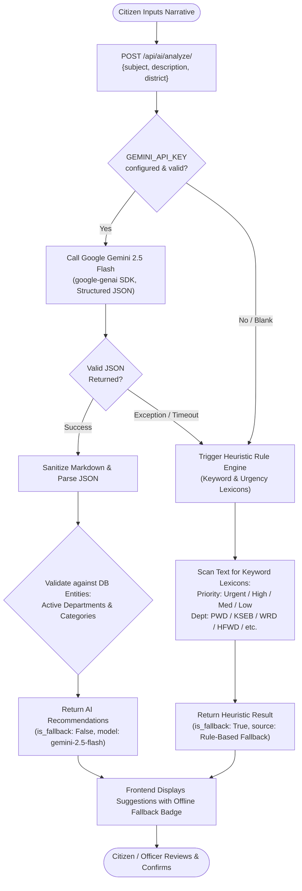

# Janaseva Kerala — AI Integration & Grievance Triage Assistant

> **Google Gemini AI Architecture, Prompt Design, Database Validation, and Heuristic Fallback Engine**  
> *Chief Minister's Public Grievance Redressal Portal*

---

> [!WARNING]
> ### Prototype Evaluation Disclaimer
> **This system is an evaluation prototype developed for WhiteMatrix Software Solutions.**  
> It is **NOT** an official AI advisory system of the Government of Kerala. All AI models, classifications, and heuristics are intended for evaluation purposes.

---

## 1. Overview & Operational Principles

The AI Grievance Assistant in **Janaseva Kerala** is designed around a **Human-in-the-Loop Advisory** architecture. In civic governance, automated decision-making without administrative verification introduces risks of misrouting or procedural error.

### Key Principles
1. **Advisory by Design**: The AI engine provides real-time recommendations during grievance drafting and CMO triage. It never automatically submits or reassigns grievances without human review.
2. **Defensive Fallback**: If external API keys are missing, rate limits are reached, or network connectivity is unavailable, an offline heuristic rule engine processes the complaint immediately with zero downtime.
3. **Database-Constrained Generation**: The system injects the actual list of active departments and canonical grievance categories from the PostgreSQL database directly into the model prompt and validates all predictions.
4. **Data Privacy**: Only the grievance `subject`, `description`, and `district` are transmitted to the model. Personal Identifiable Information (PII) such as phone numbers, emails, and residential addresses are excluded.
5. **Transparency**: The API and frontend explicitly report whether recommendations were generated by live Google Gemini AI or the offline heuristic fallback engine.

---

## 2. Technical Implementation



### 2.1 SDK and Model Configuration
- **Package**: `google-genai` (v3.4.0) — Modern official Google Gen AI SDK
- **Model**: `gemini-2.5-flash`
- **API Version**: `v1beta` (enables structured JSON output via `response_mime_type="application/json"`)
- **Temperature**: `0.2` (low temperature for deterministic classification consistency)
- **Configuration**:
  ```python
  from google import genai
  from google.genai import types

  client = genai.Client(
      api_key=api_key.strip(),
      http_options={'api_version': 'v1beta', 'timeout': 10000}
  )
  config = types.GenerateContentConfig(
      response_mime_type="application/json",
      temperature=0.2,
  )
  ```

### 2.2 Dynamic Database Validation
Before calling the model, `GeminiService` queries the application database:
- **Departments**: `Department.objects.filter(is_active=True).values_list('name', flat=True)`
- **Categories**: Canonical choices from `GrievanceCategory.choices`
- **Priorities**: `['Low', 'Medium', 'High', 'Urgent']`

These active entities are passed directly into the system prompt. Post-generation, the response is validated and normalized against database records to guarantee referential validity.

---

## 3. System Prompt Design

```python
prompt = f"""You are an expert grievance triage assistant for Janaseva Kerala (Chief Minister's Public Grievance Redressal System, Government of Kerala).
Analyze the following citizen complaint and provide classification recommendations:
- Subject: {subject}
- Description: {description}
- District: {district if district else 'Not specified'}

ALLOWED DEPARTMENTS (Choose exactly one from this list):
{json.dumps(active_departments)}

ALLOWED CATEGORIES (Choose exactly one from this list):
{json.dumps(valid_categories)}

ALLOWED PRIORITIES:
["Low", "Medium", "High", "Urgent"] (Use Urgent only for severe life-safety emergencies, immediate public hazards, or critical disasters).

Return a single JSON object with the following keys:
1. "summary": A concise 1-2 sentence executive summary of the issue.
2. "suggested_department": Exactly one department from the ALLOWED DEPARTMENTS list.
3. "suggested_category": Exactly one category from the ALLOWED CATEGORIES list.
4. "suggested_priority": Exactly one priority level from ["Low", "Medium", "High", "Urgent"].
5. "reasoning": A brief 1-2 sentence rationale for the recommended department, category, and priority.

Ensure the response is strictly valid JSON with no additional markdown formatting."""
```

---

## 4. Rule-Based Heuristic Fallback Engine

When `GEMINI_API_KEY` is not provided or if external API communication fails, `GeminiService._get_fallback_analysis()` activates immediately.

### 4.1 Priority Determination
Evaluates keyword lexicons across severity levels:
- **Urgent**: `emergency`, `danger`, `hazard`, `electrocution`, `collapse`, `death`, `casualty`, `life-threatening`, `sparking`, `fire disaster`
- **High**: `urgent`, `hospital emergency`, `epidemic`, `fever outbreak`, `contamination`, `sewage overflow`, `broken live wire`, `theft`, `assault`
- **Low**: `inquiry`, `information`, `delay in certificate`, `suggestion`, `routine`
- **Medium**: Default if no specific trigger is found

### 4.2 Department & Category Lexicon Mapping
- **Electricity (`Kerala State Electricity Board`)**: `electricity`, `power`, `current`, `voltage`, `kseb`, `transformer`, `power cut`, `meter`, `wire`, `pole`
- **Water Resources (`Water Resources Department`)**: `water`, `pipe`, `leak`, `drinking water`, `tap`, `kwa`, `borewell`, `water supply`
- **Healthcare (`Health and Family Welfare Department`)**: `hospital`, `doctor`, `nurse`, `medicine`, `health`, `clinic`, `phc`, `chc`, `ambulance`, `fever`, `dengue`
- **Education (`General Education Department`)**: `school`, `teacher`, `student`, `education`, `college`, `exam`, `class`
- **Public Works (`Public Works Department`)**: `road`, `bridge`, `pothole`, `highway`, `tarring`, `pavement`, `pwd`, `culvert`
- **Local Self Government (`Local Self Government Department`)**: `garbage`, `waste`, `panchayat`, `municipality`, `corporation`, `drainage`, `cleaning`
- **Transport (`Transport Department`)**: `bus`, `ksrtc`, `traffic`, `transport`, `conductor`, `fare`, `rto`
- **Revenue (`Revenue Department`)**: `land`, `survey`, `patta`, `village office`, `tax`, `property`, `pokkuvaravu`

---

## 5. API Response Payload

Whether evaluated by live Gemini or the heuristic fallback, `POST /api/ai/analyze/` returns a standardized JSON structure:

```json
{
  "summary": "Heavy water leakage from the main pipeline causing road flooding in Aluva.",
  "suggested_department": "Water Resources Department",
  "suggested_category": "Water Resources",
  "suggested_priority": "High",
  "reasoning": "A heavy water leakage from a main pipeline leading to road flooding indicates critical utility infrastructure failure requiring immediate repair.",
  "is_fallback": false,
  "source": "Google Gemini AI (gemini-2.5-flash)",
  "model": "gemini-2.5-flash"
}
```

### Response Fields
- `summary` *(string)*: A 1–2 sentence executive summary of the grievance.
- `suggested_department` *(string)*: Recommended Kerala Government department (validated against active DB departments).
- `suggested_category` *(string)*: Recommended grievance category (validated against DB choices).
- `suggested_priority` *(string)*: One of `Low`, `Medium`, `High`, or `Urgent`.
- `reasoning` *(string)*: Justification for the recommendations.
- `is_fallback` *(boolean)*: `false` when generated by live Gemini AI; `true` when produced by the offline fallback engine.
- `source` *(string)*: Identification of the engine (`Google Gemini AI (gemini-2.5-flash)` or `Rule-Based Fallback Engine`).
- `model` *(string or null)*: Model identifier when live AI is used.

---

## 6. Frontend Presentation & Transparency

On the citizen grievance submission page (`/citizen/submit`):
1. **Model Transparency Badge**:
   - Live Gemini: Displays an emerald badge: `✨ Live Google Gemini AI (gemini-2.5-flash)`
   - Fallback: Displays an amber badge: `Offline Heuristic Fallback`
2. **Interactive Recommendations**: Displays the suggested department, category, priority, and summary in distinct cards.
3. **Application Control**: Citizens click **"Apply Recommendations to Form"** to transfer recommendations to the form fields, maintaining human review before final submission.
4. **Footer Disclaimer**: Displays engine origin with explicit reminder: *"Human citizen review required prior to submission"*.

---

## 7. Security & Key Management

- **Backend-Only Storage**: `GEMINI_API_KEY` is loaded exclusively in `backend/.env` and read server-side via `django.conf.settings`.
- **Zero Exposure**: The key is never returned in API responses, never exposed in client bundles, and never logged in server outputs.
- **Fail-Safe Operation**: If external network access is blocked or credentials are invalid, the application falls back gracefully without breaking user requests.
