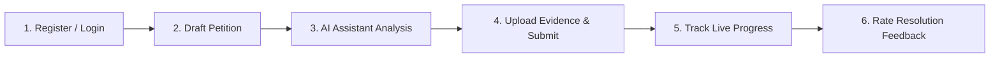

# Janaseva Kerala — User & Operational Guide

> **Operational Manual for Citizens, Department Officers, and CMO Administrators**  
> *Chief Minister's Public Grievance Redressal Portal*

---

> [!WARNING]
> ### Prototype Evaluation Disclaimer
> **This system is an evaluation prototype developed for WhiteMatrix Software Solutions.**  
> It is **NOT** an official portal of the Government of Kerala. All user flows, procedures, and credentials are provided for functional demonstration and testing.

---

## 1. Quick Reference Credentials

Use these pre-seeded demo accounts to test each role's functionality:

| Portal Tier | Email Address | Password | Primary Capabilities |
| :--- | :--- | :--- | :--- |
| **CMO Administrator** | `cmo@janaseva.kerala.gov.in` | `admin123` | Statewide triage, department assignment, internal remarks, ATR approvals, priority escalation, analytics. |
| **Department Officer** | `officer.pwd@janaseva.kerala.gov.in` | `officer123` | Assigned queue, field investigation updates, Action Taken Report (ATR) drafting. *(Also available: `officer.kseb@...`, `officer.hlt@...`)* |
| **Citizen** | `citizen@example.com` | `citizen123` | File petitions, live AI triage assistant, document attachments, track progress, submit feedback. |

---

## 2. Citizen Portal User Guide

The Citizen Portal enables any resident of Kerala to register complaints, receive status alerts, and hold public departments accountable.

### 2.1 Registration & Authentication
1. Navigate to the portal header and click **"Register"** (or go to `/register`).
2. Provide your **Full Name**, **Email Address**, **Mobile Number**, and a secure **Password**.
3. Click **"Create Account"**. Upon success, you are logged in automatically and redirected to your Citizen Dashboard.
4. For returning users, click **"Sign In"** (`/login`) and authenticate using your email and password.

---

### 2.2 Submitting a New Grievance
1. From the Citizen Dashboard or navigation bar, click **"File Grievance"** (`/citizen/submit`).
2. **Select Revenue District**: Choose one of the 14 Kerala districts where the issue is located (e.g. *Thiruvananthapuram, Ernakulam, Kozhikode*).
3. **Enter Subject**: Write a concise, descriptive title (e.g., *“Broken high-tension power line near Private Bus Stand”*).
4. **Enter Description**: Detail the issue with factual context (exact landmark, duration of the issue, public impact).
5. **Use AI Assistant (Recommended)**:
   - Click the **"✨ Analyze with AI Assistant"** button next to the description.
   - The AI Assistant evaluates your text and returns recommended **Category**, **Department**, **Priority**, and an **Executive Summary**.
   - Review the recommendations and click **"Apply AI Suggestions"** to populate form fields automatically. You may modify any suggestion at will.
6. **Upload Supporting Documents**:
   - Click **"Attach File"** to upload photographic proof or relevant PDF documents (max 10MB; formats: JPG, PNG, PDF).
7. **Submit Petition**: Click **"Submit Grievance"**.
8. **Save Reference Number**: You will receive a unique tracking reference (e.g. `JK-2026-000006`). You can use this code for tokenless public tracking.

---

### 2.3 Monitoring Your Grievances
1. Navigate to **"My Grievances"** (`/citizen/grievances`).
2. Filter your submissions by **Status** (*Submitted, Under Review, In Progress, Resolved, Reopened*), **Priority**, or keyword search.
3. Click on any grievance to view the **Detailed Dossier**:
   - Current status badge and priority chip.
   - Designated government department and assigned nodal officer.
   - Expected resolution due date.
   - **Chronological Investigation History**: Timestamped timeline showing when the petition was received, assigned, inspected, and resolved.

---

### 2.4 Submitting Resolution Feedback
1. Once your grievance moves to **Resolved** status, navigate to the grievance details page.
2. A **"Resolution Feedback"** card will appear.
3. Select a **Star Rating (1 to 5 Stars)** representing your satisfaction with the redressal quality and speed.
4. Enter qualitative comments (e.g., *“Potholes were filled smoothly before the monsoon. Excellent response from PWD team.”*).
5. Click **"Submit Feedback"**. Your rating helps the CMO evaluate departmental performance.

---

### 2.5 In-App Notifications
- Click the **Bell Icon** in the top navigation bar to access notifications.
- Visual badges alert you whenever your grievance is assigned, updated by an officer, or marked resolved.
- Click **"Mark All as Read"** to clear unread badges.

---

## 3. Department Officer Portal User Guide

The Officer Portal is designed for departmental investigators and nodal engineers (e.g., PWD Executive Engineers, KSEB Assistant Engineers).

### 3.1 Officer Login & Dashboard
1. Log in using departmental officer credentials (e.g., `officer.pwd@janaseva.kerala.gov.in` / `officer123`).
2. The **Officer Dashboard** (`/officer/dashboard`) immediately displays:
   - Department workload summary (*Total Assigned, Under Review, In Progress, Resolved*).
   - Urgent grievance warnings requiring immediate intervention.
   - SLA countdown indicators highlighting complaints nearing their deadline.

---

### 3.2 Managing the Assigned Grievance Queue
1. Click **"Assigned Grievances"** (`/officer/grievances`).
2. Search and filter complaints by district, priority, or status.
3. Select a grievance to open its full operational dossier.
4. Review the citizen's original statement, location, and uploaded photographic evidence.

---

### 3.3 Updating Ground Investigation Status
1. On the grievance details page, locate the **"Update Investigation Status"** action panel.
2. Update the status:
   - Move from `Submitted` / `Under Review` to **`In Progress`** once field investigation has commenced.
3. Provide an official narrative update in **Remarks** (e.g., *“Road maintenance squad mobilized to junction. Bituminous patching materials dispatched.”*).
4. Click **"Update Status"**. This generates a timestamped entry in the citizen's audit timeline.

---

### 3.4 Drafting & Submitting Action Taken Report (ATR)
1. Upon completing ground redressal, locate the **"Submit Action Taken Report (ATR)"** section.
2. **Report Text**: Write a comprehensive, factual summary of the corrective action taken, including dates of inspection, materials used, and authorizing engineers.
3. **Attach Proof**: Upload site completion photographs or completion certificates (PDF/JPG).
4. Click **"Submit Action Taken Report"**.
5. The report is submitted to the **CMO Administration** for scrutiny. The grievance status remains active until approved by the CMO.

---

## 4. CMO Administrator Portal User Guide

The Chief Minister's Office (CMO) Administrator holds statewide supervisory and enforcement authority.

### 4.1 Statewide Command Center & KPIs
1. Log in using `cmo@janaseva.kerala.gov.in` / `admin123`.
2. The **CMO Dashboard** (`/cmo/dashboard`) presents an executive overview:
   - Total complaints received statewide.
   - Active caseload breakdown across workflow states.
   - **Overdue SLA Alerts**: Highlights petitions that have breached targeted resolution deadlines.
   - Real-time stream of incoming high-priority and urgent petitions.

---

### 4.2 Triage & Department Assignment
1. Navigate to **"Grievance Triage"** (`/cmo/grievances`).
2. Filter for grievances in **Submitted** status.
3. Open a grievance and review the **AI Advisory recommendation**.
4. In the **"Department Assignment"** card:
   - Select the target department (e.g. *Public Works Department*).
   - Designate a specific nodal officer from the dropdown.
   - Set a strict **Resolution Due Date** based on priority.
   - Add administrative **Assignment Instructions** (e.g. *“Direct inspection mandated within 48 hours under disaster relief quota.”*).
5. Click **"Assign Department"**. The grievance moves to `Under Review` and an immediate notification is dispatched to the assigned officer.

---

### 4.3 Confidential Internal Remarks
1. To record internal government deliberations not visible to citizens or the public:
2. Navigate to the **"Internal Remarks"** section of any grievance dossier.
3. Enter confidential notes (e.g., *“Discussed with District Collector. Special funding approved under MP-LAD scheme.”*).
4. Click **"Add Remark"**. This note is timestamped and restricted strictly to CMO administrators.

---

### 4.4 Reviewing Action Taken Reports (ATRs)
1. When an officer submits an ATR, it appears in the CMO queue with review status **Pending**.
2. Open the grievance and review the officer's report narrative and uploaded completion evidence.
3. Select an administrative determination:
   - **Approve**: Confirms the redressal is satisfactory. Moves grievance status to **`Resolved`**, timestamps `resolved_at`, and prompts the citizen for feedback.
   - **Request Revision**: Leaves grievance `In Progress`. Nodal officer is instructed to rectify report deficiencies or furnish additional evidence.
   - **Reject / Re-investigate**: Rejects findings and directs re-investigation by superior authorities.
4. Enter official **CMO Remarks** and submit the review.

---

### 4.5 Priority Escalation
1. If a complaint involves imminent public danger or escalation during a public hearing:
2. Click **"Escalate Priority"** on the grievance dossier.
3. Elevate the priority to **High** or **Urgent**.
4. An automated high-priority alert is sent to the department nodal officer.

---

### 4.6 Statewide Analytics & Reporting
1. Navigate to **"Analytics"** (`/cmo/analytics`).
2. Review interactive visual reports:
   - **Monthly Trends**: 6-month historical graph tracking incoming petitions vs. completed resolutions.
   - **District Distribution**: Bar charts showing grievance density across Kerala's 14 districts.
   - **Category Distribution**: Pie chart illustrating public concern areas (Roads, Water, Power, Sanitation).
   - **Departmental Performance Rankings**: Benchmark table comparing total assigned grievances against resolution rates and average turnaround times.
3. Apply filters by District or Category to analyze regional civic performance.

---

## 5. Public Tools & Information Services

Janaseva Kerala includes open-access civic features accessible to all visitors without requiring account registration:

| Feature | URL Path | Operational Utility |
| :--- | :--- | :--- |
| **Track Grievance** | `/track` | Enter any reference number (`JK-YYYY-XXXXXX`) to inspect live status, assigned department, and audit history. |
| **Department Directory** | `/departments` | Public catalog of all 8 state departments, administrative mandates, and official nodal emails. |
| **How It Works** | `/how-it-works` | Step-by-step citizen walkthrough explaining the petition lifecycle from filing to resolution. |
| **Knowledge Base & FAQ** | `/faq` | Accordion answering common questions regarding SLAs, appeal mechanisms, and evidence requirements. |
| **Contact & Enquiries** | `/contact` | Public contact form routing general citizen inquiries directly to administration staff. |

---

## 6. Frequently Asked Questions (FAQ)

### Q1: What is the turnaround time for grievance redressal?
> **Answer**: Turnaround times follow the Kerala Right to Services norms:  
> - **Urgent** *(immediate life safety)*: 24 to 48 hours  
> - **High** *(water/power outages, health hazards)*: Up to 5 business days  
> - **Medium** *(road defects, sanitation)*: Up to 14 business days  
> - **Low** *(general administrative matters)*: Up to 30 calendar days  

### Q2: What if an officer marks my grievance resolved but the issue persists?
> **Answer**: If ground work is substandard or incomplete, citizens can request reopening by filing a follow-up or submitting feedback with a 1-star rating. The CMO Administrator regularly audits low-rated resolutions and can reopen the complaint for re-investigation.

### Q3: Who can view the Internal Remarks on my petition?
> **Answer**: Internal remarks are visible strictly to authorized staff within the Chief Minister's Office. Neither the citizen nor general public visitors can view internal administrative notes.

### Q4: Does the AI assistant automatically approve or reject petitions?
> **Answer**: No. The AI assistant functions strictly in an advisory capacity. It only recommends classification categories and drafts summaries. All routing, investigation, and closure decisions are authorized by human officers.
